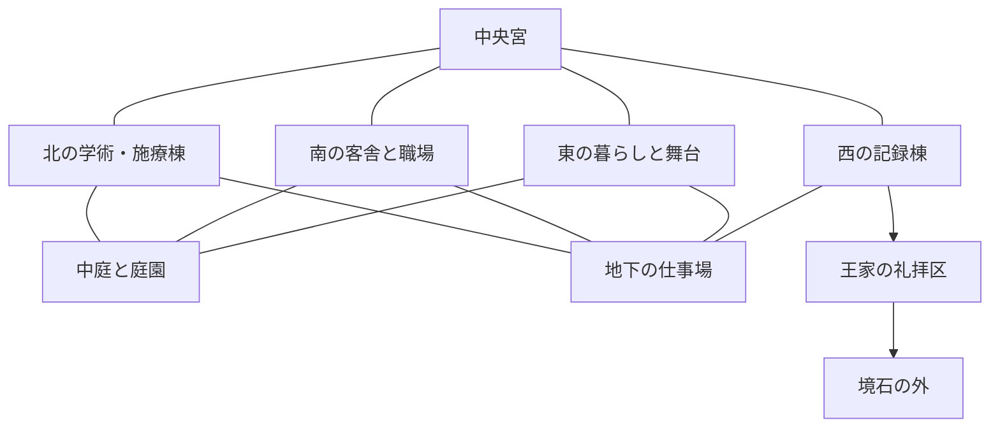

# 城内地図　59地点

[資料の目次](README.md) ・ [最短行程](main-route.md) ・ [城内地図](castle.md) ・ [人物](cast.md) ・ [重要品](items.md)

各部屋の「徒歩で隣接」をたどると、次にどこへ行けるか分かる。移動は双方向。敷地外の草地を含む境界地点はQ05だけで、南門検札所も馬車溜も敷地内にある。

謁見前はC01のみ。謁見後は中央宮から四方と庭、地下の職場へ歩ける。W04→Q01は香車の予約後。Q01→Q02は解除後、Q02→Q03は未発見での横断後、Q03→Q04は像の開扉後。Q04からQ05の外側に足を置く操作が最終行程。逃走中の目撃・失敗で戻る先は[状態と死に戻り](rules.md)に示す。

図は区域間の代表的な移動を示す。個々の直通路は下の「徒歩で隣接」にすべて載せた。

## 中央宮

### C01　玉座の間

赤い絨毯の先に玉座がある。王の席と客の席では、織物の見え方が違う。

**徒歩で隣接**　[C02 拝謁前室](#c02)

**ここで起こる場面**　[M01](main-route.md#m01) ・ [M02](main-route.md#m02) ・ [E001](threads/T01.md#e001) ・ [E002](threads/T01.md#e002) ・ [E011](threads/T01.md#e011)

### C02　拝謁前室

侍従が客を並ばせている。外の景色に見えるのは、壁に掛かった舞台幕だ。

**徒歩で隣接**　[C01 玉座の間](#c01) ／ [C03 紋章廊](#c03) ／ [C05 衣装小部屋](#c05) ／ [C07 中央回廊](#c07)

**ここで起こる場面**　[E003](threads/T01.md#e003) ・ [E006](threads/T01.md#e006) ・ [E013](threads/T01.md#e013)

### C03　紋章廊

作法ごとの身振りが、指でなぞれる浮き彫りになっている。

**徒歩で隣接**　[C02 拝謁前室](#c02) ／ [C04 楽師桟敷](#c04) ／ [W03 肖像修復室](#w03)

**ここで起こる場面**　[E005](threads/T01.md#e005) ・ [E007](threads/T01.md#e007) ・ [E014](threads/T01.md#e014)

### C04　楽師桟敷

舞台の床を伝って、客席まで音が届く。楽師の合図は灯でもわかる。

**徒歩で隣接**　[C03 紋章廊](#c03) ／ [E08 小劇場](#e08)

**ここで起こる場面**　[E197](threads/T14.md#e197) ・ [E201](threads/T14.md#e201) ・ [E203](threads/T14.md#e203) ・ [E206](threads/T14.md#e206) ・ [E210](threads/T14.md#e210) ・ [E224](threads/T15.md#e224)

### C05　衣装小部屋

稽古用の剣と客用の礼装が、別々の箱に入っている。

**徒歩で隣接**　[C02 拝謁前室](#c02) ／ [C08 客人寝室](#c08) ／ [E04 衣装繕い室](#e04)

**ここで起こる場面**　[E009](threads/T01.md#e009) ・ [E101](threads/T07.md#e101) ・ [E212](threads/T15.md#e212) ・ [E213](threads/T15.md#e213) ・ [E220](threads/T15.md#e220)

### C06　客人談話室

城に召喚された客が書き残したメモが、椅子のそばにある。

**徒歩で隣接**　[C07 中央回廊](#c07) ／ [C08 客人寝室](#c08) ／ [S02 冬客間](#s02)

**ここで起こる場面**　[E008](threads/T01.md#e008) ・ [E010](threads/T01.md#e010) ・ [E063](threads/T05.md#e063) ・ [E071](threads/T05.md#e071) ・ [E160](threads/T11.md#e160) ・ [E178](threads/T12.md#e178) ・ [E235](threads/T16.md#e235) ・ [E238](threads/T16.md#e238) ・ [E266](threads/T18.md#e266)

### C07　中央回廊

四つの棟と庭を結ぶ廊下だ。床の色と壁の浮き彫りが、方角の目印になる。

**徒歩で隣接**　[C02 拝謁前室](#c02) ／ [C06 客人談話室](#c06) ／ [E02 東廊下](#e02) ／ [G02 中庭の噴水](#g02) ／ [N02 施療院](#n02) ／ [S05 城内の馬車待ち場](#s05) ／ [W01 西資料室](#w01)

**ここで起こる場面**　[E015](threads/T01.md#e015)

### C08　客人寝室

召喚された客の荷物を預かる部屋だ。机には書きものができる場所が空いている。

**徒歩で隣接**　[C05 衣装小部屋](#c05) ／ [C06 客人談話室](#c06) ／ [S02 冬客間](#s02)

**ここで起こる場面**　[E012](threads/T01.md#e012) ・ [E066](threads/T05.md#e066) ・ [E094](threads/T07.md#e094) ・ [E226](threads/T16.md#e226) ・ [E237](threads/T16.md#e237)

## 西の記録棟

### W01　西資料室

貸出棚に、備品の移動先まで書き込まれた古い図がある。

**徒歩で隣接**　[C07 中央回廊](#c07) ／ [W02 織物回廊](#w02) ／ [W05 写字室](#w05) ／ [W06 地図架室](#w06)

**ここで起こる場面**　[M03](main-route.md#m03)

### W02　織物回廊

織物の裏側に回ると、短い日なたを横切る足場がある。織物の表側は自由に通れる。

**徒歩で隣接**　[W01 西資料室](#w01) ／ [W03 肖像修復室](#w03) ／ [W08 壁画足場](#w08)

**ここで起こる場面**　[M10](main-route.md#m10) ・ [E080](threads/T06.md#e080) ・ [E082](threads/T06.md#e082) ・ [E088](threads/T06.md#e088)

### W03　肖像修復室

王女の肖像が掛かっている。そばには裏紙を傾けて調べるための台がある。

**徒歩で隣接**　[C03 紋章廊](#c03) ／ [W02 織物回廊](#w02) ／ [W04 香支度室](#w04) ／ [W08 壁画足場](#w08)

**ここで起こる場面**　[M14](main-route.md#m14) ・ [E136](threads/T10.md#e136) ・ [E140](threads/T10.md#e140) ・ [E144](threads/T10.md#e144) ・ [E147](threads/T10.md#e147) ・ [E148](threads/T10.md#e148) ・ [E150](threads/T10.md#e150)

### W04　香支度室

香車の返却時刻を、当番盤に合わせて予約できる。奥には無音祈祷室の扉がある。

**徒歩で隣接**　[Q01 無音祈祷室](#q01) ／ [W03 肖像修復室](#w03)

**ここで起こる場面**　[M16](main-route.md#m16) ・ [E258](threads/T18.md#e258) ・ [E259](threads/T18.md#e259) ・ [E262](threads/T18.md#e262) ・ [E265](threads/T18.md#e265) ・ [E267](threads/T18.md#e267) ・ [E269](threads/T18.md#e269)

### W05　写字室

紙に残った筆跡をたどれば、誰が書いたかわかることがある。

**徒歩で隣接**　[W01 西資料室](#w01) ／ [W07 製本台の間](#w07)

**ここで起こる場面**　[E131](threads/T09.md#e131) ・ [E138](threads/T10.md#e138) ・ [E142](threads/T10.md#e142) ・ [E149](threads/T10.md#e149) ・ [E188](threads/T13.md#e188) ・ [E219](threads/T15.md#e219) ・ [E231](threads/T16.md#e231) ・ [E236](threads/T16.md#e236)

### W06　地図架室

年代ごとの地図が掛かっている。地図に「外」とあっても、まだ城の敷地内かもしれない。

**徒歩で隣接**　[B06 帳票庫](#b06) ／ [N08 標本廊](#n08) ／ [W01 西資料室](#w01) ／ [W07 製本台の間](#w07)

**ここで起こる場面**　[E092](threads/T07.md#e092) ・ [E103](threads/T07.md#e103)

### W07　製本台の間

箱の底に、製本で余った紙が敷かれている。

**徒歩で隣接**　[B06 帳票庫](#b06) ／ [W05 写字室](#w05) ／ [W06 地図架室](#w06)

**ここで起こる場面**　[E097](threads/T07.md#e097) ・ [E139](threads/T10.md#e139) ・ [E228](threads/T16.md#e228) ・ [E234](threads/T16.md#e234) ・ [E239](threads/T16.md#e239)

### W08　壁画足場

足場に上がると、壁画の継ぎ目を間近で調べられる。

**徒歩で隣接**　[G03 果樹回廊](#g03) ／ [W02 織物回廊](#w02) ／ [W03 肖像修復室](#w03)

**ここで起こる場面**　[E043](threads/T03.md#e043) ・ [E083](threads/T06.md#e083) ・ [E137](threads/T10.md#e137) ・ [E141](threads/T10.md#e141) ・ [E143](threads/T10.md#e143) ・ [E145](threads/T10.md#e145) ・ [E146](threads/T10.md#e146)

## 東の暮らしと舞台

### E01　洗濯仕分け場

干し台の表には今日の洗濯物が、裏には古い印の付いた札が掛かっている。

**徒歩で隣接**　[E02 東廊下](#e02) ／ [E04 衣装繕い室](#e04) ／ [E05 物干し屋根](#e05)

**ここで起こる場面**　[M04](main-route.md#m04) ・ [E016](threads/T02.md#e016) ・ [E018](threads/T02.md#e018) ・ [E027](threads/T02.md#e027) ・ [E029](threads/T02.md#e029)

### E02　東廊下

壁際に星の焼き印がある箱が置かれている。舞台で使った物の返却用だ。

**徒歩で隣接**　[C07 中央回廊](#c07) ／ [E01 洗濯仕分け場](#e01) ／ [E06 舞台倉](#e06) ／ [E07 東詰所](#e07)

**ここで起こる場面**　[M09](main-route.md#m09) ・ [E021](threads/T02.md#e021) ・ [E030](threads/T02.md#e030)

### E03　王家の鳩舎

世話道具の棚の上に、王女の返書を入れる専用の筒がある。

**徒歩で隣接**　[E05 物干し屋根](#e05) ／ [N06 天文露台](#n06)

**ここで起こる場面**　[M13](main-route.md#m13) ・ [E121](threads/T09.md#e121) ・ [E122](threads/T09.md#e122) ・ [E124](threads/T09.md#e124) ・ [E126](threads/T09.md#e126) ・ [E128](threads/T09.md#e128) ・ [E132](threads/T09.md#e132) ・ [E133](threads/T09.md#e133)

### E04　衣装繕い室

縁や裏地の縫い方から、どんな仕事の服か見分けられる。

**徒歩で隣接**　[C05 衣装小部屋](#c05) ／ [E01 洗濯仕分け場](#e01) ／ [E06 舞台倉](#e06)

**ここで起こる場面**　[E017](threads/T02.md#e017) ・ [E020](threads/T02.md#e020) ・ [E022](threads/T02.md#e022) ・ [E024](threads/T02.md#e024) ・ [E229](threads/T16.md#e229)

### E05　物干し屋根

屋根の端に風向きを知らせる旗が揺れ、鳩の雨よけが取り付けてある。

**徒歩で隣接**　[E01 洗濯仕分け場](#e01) ／ [E03 王家の鳩舎](#e03) ／ [G03 果樹回廊](#g03)

**ここで起こる場面**　[E023](threads/T02.md#e023) ・ [E025](threads/T02.md#e025) ・ [E026](threads/T02.md#e026) ・ [E123](threads/T09.md#e123) ・ [E127](threads/T09.md#e127) ・ [E130](threads/T09.md#e130) ・ [E135](threads/T09.md#e135)

### E06　舞台倉

衣装箱には、舞台で使う宝箱や小道具も一緒にしまってある。

**徒歩で隣接**　[B05 舞台奈落](#b05) ／ [E02 東廊下](#e02) ／ [E04 衣装繕い室](#e04) ／ [E08 小劇場](#e08)

**ここで起こる場面**　[E028](threads/T02.md#e028) ・ [E076](threads/T06.md#e076) ・ [E079](threads/T06.md#e079) ・ [E084](threads/T06.md#e084) ・ [E089](threads/T06.md#e089) ・ [E217](threads/T15.md#e217)

### E07　東詰所

立入禁止の線より手前に、落とし物を受け取れる窓口がある。

**徒歩で隣接**　[E02 東廊下](#e02) ／ [S05 城内の馬車待ち場](#s05)

**ここで起こる場面**　[E085](threads/T06.md#e085) ・ [E260](threads/T18.md#e260) ・ [E263](threads/T18.md#e263) ・ [E264](threads/T18.md#e264)

### E08　小劇場

幕の向こうから舞台袖が見える。客席と舞台を仕切る幕は、上に巻き上げられる。

**徒歩で隣接**　[B05 舞台奈落](#b05) ／ [C04 楽師桟敷](#c04) ／ [E06 舞台倉](#e06)

**ここで起こる場面**　[E004](threads/T01.md#e004) ・ [E077](threads/T06.md#e077) ・ [E081](threads/T06.md#e081) ・ [E087](threads/T06.md#e087) ・ [E090](threads/T06.md#e090) ・ [E157](threads/T11.md#e157) ・ [E211](threads/T15.md#e211) ・ [E214](threads/T15.md#e214) ・ [E216](threads/T15.md#e216) ・ [E218](threads/T15.md#e218) ・ [E223](threads/T15.md#e223) ・ [E225](threads/T15.md#e225)

## 北の学術・施療棟

### N01　窯見本室

釉薬の色が似ていても、見本の縁や裏の溝には違いがある。

**徒歩で隣接**　[N02 施療院](#n02) ／ [N05 鐘鋳場](#n05)

**ここで起こる場面**　[M05](main-route.md#m05) ・ [E031](threads/T03.md#e031) ・ [E032](threads/T03.md#e032) ・ [E035](threads/T03.md#e035) ・ [E039](threads/T03.md#e039) ・ [E041](threads/T03.md#e041) ・ [E042](threads/T03.md#e042)

### N02　施療院

棚には救護札と、召喚された人の診察記録が収められている。

**徒歩で隣接**　[C07 中央回廊](#c07) ／ [N01 窯見本室](#n01) ／ [N04 薬草乾燥室](#n04) ／ [N07 療養温室](#n07)

**ここで起こる場面**　[M07](main-route.md#m07) ・ [E019](threads/T02.md#e019) ・ [E059](threads/T04.md#e059) ・ [E061](threads/T05.md#e061) ・ [E064](threads/T05.md#e064) ・ [E067](threads/T05.md#e067) ・ [E069](threads/T05.md#e069) ・ [E072](threads/T05.md#e072) ・ [E073](threads/T05.md#e073)

### N03　星暦室

王家が冬至の星を読むのに使った盤が残っている。

**徒歩で隣接**　[N06 天文露台](#n06) ／ [N08 標本廊](#n08)

**ここで起こる場面**　[M12](main-route.md#m12) ・ [E106](threads/T08.md#e106) ・ [E111](threads/T08.md#e111) ・ [E112](threads/T08.md#e112) ・ [E117](threads/T08.md#e117) ・ [E119](threads/T08.md#e119)

### N04　薬草乾燥室

薬草は使い道ごとに、違う高さのひもに干してある。

**徒歩で隣接**　[N02 施療院](#n02) ／ [N07 療養温室](#n07)

**ここで起こる場面**　[E062](threads/T05.md#e062) ・ [E065](threads/T05.md#e065) ・ [E070](threads/T05.md#e070) ・ [E249](threads/T17.md#e249)

### N05　鐘鋳場

まだ音を鳴らしたことのない鐘が並ぶ。表面に作り手の印がある。

**徒歩で隣接**　[B03 からくり工房](#b03) ／ [N01 窯見本室](#n01) ／ [N08 標本廊](#n08)

**ここで起こる場面**　[E038](threads/T03.md#e038) ・ [E196](threads/T14.md#e196) ・ [E200](threads/T14.md#e200) ・ [E202](threads/T14.md#e202) ・ [E204](threads/T14.md#e204) ・ [E205](threads/T14.md#e205) ・ [E208](threads/T14.md#e208)

### N06　天文露台

ここからは風向きも星の位置も確かめられる。

**徒歩で隣接**　[E03 王家の鳩舎](#e03) ／ [G04 日時計庭](#g04) ／ [N03 星暦室](#n03)

**ここで起こる場面**　[E107](threads/T08.md#e107) ・ [E110](threads/T08.md#e110) ・ [E113](threads/T08.md#e113) ・ [E114](threads/T08.md#e114) ・ [E115](threads/T08.md#e115) ・ [E120](threads/T08.md#e120)

### N07　療養温室

低い寝台に腰掛けたまま、窓から花を眺められる。

**徒歩で隣接**　[G07 回転温棚](#g07) ／ [N02 施療院](#n02) ／ [N04 薬草乾燥室](#n04)

**ここで起こる場面**　[E068](threads/T05.md#e068) ・ [E074](threads/T05.md#e074) ・ [E075](threads/T05.md#e075) ・ [E192](threads/T13.md#e192) ・ [E241](threads/T17.md#e241) ・ [E246](threads/T17.md#e246) ・ [E251](threads/T17.md#e251) ・ [E252](threads/T17.md#e252) ・ [E254](threads/T17.md#e254) ・ [E255](threads/T17.md#e255)

### N08　標本廊

材料の見本と、王家が使った古い図形の手本が保管されている。

**徒歩で隣接**　[N03 星暦室](#n03) ／ [N05 鐘鋳場](#n05) ／ [W06 地図架室](#w06)

**ここで起こる場面**　[E033](threads/T03.md#e033) ・ [E045](threads/T03.md#e045) ・ [E108](threads/T08.md#e108) ・ [E118](threads/T08.md#e118) ・ [E129](threads/T09.md#e129)

## 南の客舎と職場

### S01　南返納庫

布札と焼き物の札をはめると開く、古い返納箱がある。

**徒歩で隣接**　[S05 城内の馬車待ち場](#s05) ／ [S08 食器棚室](#s08)

**ここで起こる場面**　[M06](main-route.md#m06) ・ [E037](threads/T03.md#e037) ・ [E044](threads/T03.md#e044)

### S02　冬客間

子供部屋から移された柱だけ、壁紙が薄い。表面には背丈を測った跡がある。

**徒歩で隣接**　[C06 客人談話室](#c06) ／ [C08 客人寝室](#c08) ／ [S06 宴会厨房](#s06)

**ここで起こる場面**　[M11](main-route.md#m11) ・ [E091](threads/T07.md#e091) ・ [E093](threads/T07.md#e093) ・ [E095](threads/T07.md#e095) ・ [E098](threads/T07.md#e098) ・ [E100](threads/T07.md#e100) ・ [E102](threads/T07.md#e102) ・ [E104](threads/T07.md#e104)

### S03　鐘番室

当番盤には見張りの交代時刻が刻まれている。貸し出し用の巡回環もある。

**徒歩で隣接**　[S04 南門検札所](#s04) ／ [S05 城内の馬車待ち場](#s05)

**ここで起こる場面**　[M15](main-route.md#m15) ・ [E165](threads/T11.md#e165) ・ [E198](threads/T14.md#e198) ・ [E209](threads/T14.md#e209) ・ [E256](threads/T18.md#e256) ・ [E257](threads/T18.md#e257) ・ [E261](threads/T18.md#e261) ・ [E268](threads/T18.md#e268) ・ [E270](threads/T18.md#e270)

### S04　南門検札所

作法を守れば内側の検札窓口までは行ける。外の扉は閉ざされている。

**徒歩で隣接**　[S03 鐘番室](#s03) ／ [S05 城内の馬車待ち場](#s05)

**ここで起こる場面**　[E151](threads/T11.md#e151) ・ [E152](threads/T11.md#e152) ・ [E153](threads/T11.md#e153) ・ [E155](threads/T11.md#e155) ・ [E156](threads/T11.md#e156) ・ [E159](threads/T11.md#e159) ・ [E161](threads/T11.md#e161) ・ [E163](threads/T11.md#e163)

### S05　城内の馬車待ち場

町が見えるが、馬車が並んでいるのはまだ門の内側だ。

**徒歩で隣接**　[C07 中央回廊](#c07) ／ [E07 東詰所](#e07) ／ [G02 中庭の噴水](#g02) ／ [S01 南返納庫](#s01) ／ [S03 鐘番室](#s03) ／ [S04 南門検札所](#s04) ／ [S06 宴会厨房](#s06)

**ここで起こる場面**　[E154](threads/T11.md#e154) ・ [E158](threads/T11.md#e158) ・ [E162](threads/T11.md#e162) ・ [E164](threads/T11.md#e164)

### S06　宴会厨房

料理が地下から運ばれてくる。欠けた食器は別の棚へ戻す決まりだ。

**徒歩で隣接**　[B07 地下配膳廊](#b07) ／ [S02 冬客間](#s02) ／ [S05 城内の馬車待ち場](#s05) ／ [S07 パン窯室](#s07) ／ [S08 食器棚室](#s08)

**ここで起こる場面**　[E134](threads/T09.md#e134) ・ [E166](threads/T12.md#e166) ・ [E175](threads/T12.md#e175) ・ [E179](threads/T12.md#e179)

### S07　パン窯室

夜番の仕事場だ。パンの後で、まだ温かい窯を使って菓子を焼く。

**徒歩で隣接**　[B04 古い給茶室](#b04) ／ [S06 宴会厨房](#s06)

**ここで起こる場面**　[E167](threads/T12.md#e167) ・ [E170](threads/T12.md#e170) ・ [E171](threads/T12.md#e171) ・ [E176](threads/T12.md#e176)

### S08　食器棚室

皿は印ごとに分けて棚に並べてある。贈り物の箱は別の棚だ。

**徒歩で隣接**　[B07 地下配膳廊](#b07) ／ [S01 南返納庫](#s01) ／ [S06 宴会厨房](#s06)

**ここで起こる場面**　[E034](threads/T03.md#e034) ・ [E168](threads/T12.md#e168) ・ [E173](threads/T12.md#e173) ・ [E177](threads/T12.md#e177) ・ [E183](threads/T13.md#e183)

## 中庭と庭園

### G01　雨量庭園

鷺の形をした古い雨量計がある。左脚の水を抜くと預かり筒が開く。

**徒歩で隣接**　[B01 旧水位室](#b01) ／ [G02 中庭の噴水](#g02) ／ [G05 庭師小屋](#g05)

**ここで起こる場面**　[M08](main-route.md#m08) ・ [E046](threads/T04.md#e046) ・ [E051](threads/T04.md#e051) ・ [E054](threads/T04.md#e054) ・ [E058](threads/T04.md#e058)

### G02　中庭の噴水

地上の四方を見渡せる。噴水から流れた水は、どの水路も庭の池に戻る。

**徒歩で隣接**　[C07 中央回廊](#c07) ／ [G01 雨量庭園](#g01) ／ [G03 果樹回廊](#g03) ／ [G04 日時計庭](#g04) ／ [G06 舟遊び池](#g06) ／ [S05 城内の馬車待ち場](#s05)

**ここで起こる場面**　[E050](threads/T04.md#e050)

### G03　果樹回廊

果樹の枝に、物干し台の影が重なっている。

**徒歩で隣接**　[E05 物干し屋根](#e05) ／ [G02 中庭の噴水](#g02) ／ [G05 庭師小屋](#g05) ／ [G07 回転温棚](#g07) ／ [W08 壁画足場](#w08)

**ここで起こる場面**　[E057](threads/T04.md#e057) ・ [E125](threads/T09.md#e125) ・ [E244](threads/T17.md#e244) ・ [E248](threads/T17.md#e248)

### G04　日時計庭

石の切り欠きに落ちる光で時刻がわかる。

**徒歩で隣接**　[G02 中庭の噴水](#g02) ／ [G06 舟遊び池](#g06) ／ [N06 天文露台](#n06)

**ここで起こる場面**　[E109](threads/T08.md#e109) ・ [E116](threads/T08.md#e116) ・ [E189](threads/T13.md#e189) ・ [E199](threads/T14.md#e199) ・ [E207](threads/T14.md#e207)

### G05　庭師小屋

道具の形に合わせた返却棚と、水量を記録した古い帳面がある。

**徒歩で隣接**　[G01 雨量庭園](#g01) ／ [G03 果樹回廊](#g03) ／ [G06 舟遊び池](#g06)

**ここで起こる場面**　[E047](threads/T04.md#e047) ・ [E053](threads/T04.md#e053) ・ [E243](threads/T17.md#e243)

### G06　舟遊び池

舟の行き来は城内の池だけだ。水路から外へは出られない。

**徒歩で隣接**　[G02 中庭の噴水](#g02) ／ [G04 日時計庭](#g04) ／ [G05 庭師小屋](#g05) ／ [G07 回転温棚](#g07)

**ここで起こる場面**　[E049](threads/T04.md#e049) ・ [E060](threads/T04.md#e060) ・ [E096](threads/T07.md#e096) ・ [E099](threads/T07.md#e099) ・ [E105](threads/T07.md#e105) ・ [E250](threads/T17.md#e250) ・ [E253](threads/T17.md#e253)

### G07　回転温棚

鉢を載せた棚が日ごとに回る。葉の裏にも目印がある。

**徒歩で隣接**　[G03 果樹回廊](#g03) ／ [G06 舟遊び池](#g06) ／ [N07 療養温室](#n07)

**ここで起こる場面**　[E242](threads/T17.md#e242) ・ [E245](threads/T17.md#e245) ・ [E247](threads/T17.md#e247)

## 地下の仕事場

### B01　旧水位室

水位を測る板の裏に、昔の事故の記録が刻まれている。

**徒歩で隣接**　[B02 貯氷室](#b02) ／ [B03 からくり工房](#b03) ／ [G01 雨量庭園](#g01)

**ここで起こる場面**　[E048](threads/T04.md#e048) ・ [E052](threads/T04.md#e052) ・ [E055](threads/T04.md#e055) ・ [E056](threads/T04.md#e056)

### B02　貯氷室

春の氷を包んで夏まで取っておく部屋だ。入口に救護を呼ぶひもがある。

**徒歩で隣接**　[B01 旧水位室](#b01) ／ [B04 古い給茶室](#b04) ／ [B07 地下配膳廊](#b07)

**ここで起こる場面**　[E181](threads/T13.md#e181) ・ [E182](threads/T13.md#e182) ・ [E184](threads/T13.md#e184) ・ [E186](threads/T13.md#e186) ・ [E187](threads/T13.md#e187) ・ [E190](threads/T13.md#e190) ・ [E193](threads/T13.md#e193)

### B03　からくり工房

水鳥の仕掛けや鐘の、壊れた部品を試せる作業場だ。

**徒歩で隣接**　[B01 旧水位室](#b01) ／ [B05 舞台奈落](#b05) ／ [N05 鐘鋳場](#n05)

**ここで起こる場面**　[E036](threads/T03.md#e036) ・ [E040](threads/T03.md#e040)

### B04　古い給茶室

見舞い客が、仲直りのしるしに出すお茶を用意する部屋だ。

**徒歩で隣接**　[B02 貯氷室](#b02) ／ [B07 地下配膳廊](#b07) ／ [S07 パン窯室](#s07)

**ここで起こる場面**　[E169](threads/T12.md#e169) ・ [E174](threads/T12.md#e174) ・ [E180](threads/T12.md#e180) ・ [E185](threads/T13.md#e185) ・ [E191](threads/T13.md#e191) ・ [E194](threads/T13.md#e194) ・ [E195](threads/T13.md#e195)

### B05　舞台奈落

せり上がる床は真上の舞台につながっている。

**徒歩で隣接**　[B03 からくり工房](#b03) ／ [B07 地下配膳廊](#b07) ／ [E06 舞台倉](#e06) ／ [E08 小劇場](#e08)

**ここで起こる場面**　[E078](threads/T06.md#e078) ・ [E086](threads/T06.md#e086) ・ [E215](threads/T15.md#e215) ・ [E221](threads/T15.md#e221) ・ [E222](threads/T15.md#e222)

### B06　帳票庫

書き換え前の受け取り控えや、捨てられる寸前の手紙が残っている。

**徒歩で隣接**　[B07 地下配膳廊](#b07) ／ [W06 地図架室](#w06) ／ [W07 製本台の間](#w07)

**ここで起こる場面**　[E227](threads/T16.md#e227) ・ [E230](threads/T16.md#e230) ・ [E232](threads/T16.md#e232) ・ [E233](threads/T16.md#e233) ・ [E240](threads/T16.md#e240)

### B07　地下配膳廊

氷や料理を運ぶための廊下だ。奥は食器棚室につながる。

**徒歩で隣接**　[B02 貯氷室](#b02) ／ [B04 古い給茶室](#b04) ／ [B05 舞台奈落](#b05) ／ [B06 帳票庫](#b06) ／ [S06 宴会厨房](#s06) ／ [S08 食器棚室](#s08)

**ここで起こる場面**　[E172](threads/T12.md#e172)

## 王家の礼拝区と境界

### Q01　無音祈祷室

香車の予約で開く部屋だ。扉を閉めれば、首輪の留め金の音も外には漏れない。

**徒歩で隣接**　[Q02 白礼拝廊](#q02) ／ [W04 香支度室](#w04)

**ここで起こる場面**　[M17](main-route.md#m17) ・ [E271](threads/T19.md#e271) ・ [E272](threads/T19.md#e272) ・ [E273](threads/T19.md#e273) ・ [E274](threads/T19.md#e274) ・ [E275](threads/T19.md#e275) ・ [E281](threads/T19.md#e281)

### Q02　白礼拝廊

中央の白い床を見張りが照らしている。持ち場を離れた隙に、白百合のある壁際を通れそうだ。

**徒歩で隣接**　[Q01 無音祈祷室](#q01) ／ [Q03 旧礼拝堂](#q03)

**ここで起こる場面**　[M18](main-route.md#m18) ・ [E276](threads/T19.md#e276) ・ [E277](threads/T19.md#e277) ・ [E278](threads/T19.md#e278) ・ [E279](threads/T19.md#e279) ・ [E280](threads/T19.md#e280)

### Q03　旧礼拝堂

冠のない像の背には、卵形の覗き錘が収まりそうなくぼみがある。

**徒歩で隣接**　[Q02 白礼拝廊](#q02) ／ [Q04 王家の抜け穴](#q04)

**ここで起こる場面**　[M19](main-route.md#m19) ・ [E282](threads/T19.md#e282) ・ [E283](threads/T19.md#e283) ・ [E284](threads/T19.md#e284) ・ [E285](threads/T19.md#e285)

### Q04　王家の抜け穴

雨水路とは別に造られた、王家の古い通路だ。ここはまだ城の敷地内だ。

**徒歩で隣接**　[Q03 旧礼拝堂](#q03) ／ [Q05 境石と外の草地](#q05)

**ここで起こる場面**　[E286](threads/T20.md#e286) ・ [E287](threads/T20.md#e287) ・ [E288](threads/T20.md#e288) ・ [E289](threads/T20.md#e289) ・ [E290](threads/T20.md#e290) ・ [E291](threads/T20.md#e291) ・ [E292](threads/T20.md#e292) ・ [E293](threads/T20.md#e293) ・ [E294](threads/T20.md#e294) ・ [E295](threads/T20.md#e295) ・ [E296](threads/T20.md#e296)

### Q05　境石と外の草地

境石の内側には靴跡が残り、外側には野草が茂っている。

**徒歩で隣接**　[Q04 王家の抜け穴](#q04)

**ここで起こる場面**　[M20](main-route.md#m20) ・ [E297](threads/T20.md#e297) ・ [E298](threads/T20.md#e298) ・ [E299](threads/T20.md#e299) ・ [E300](threads/T20.md#e300)
