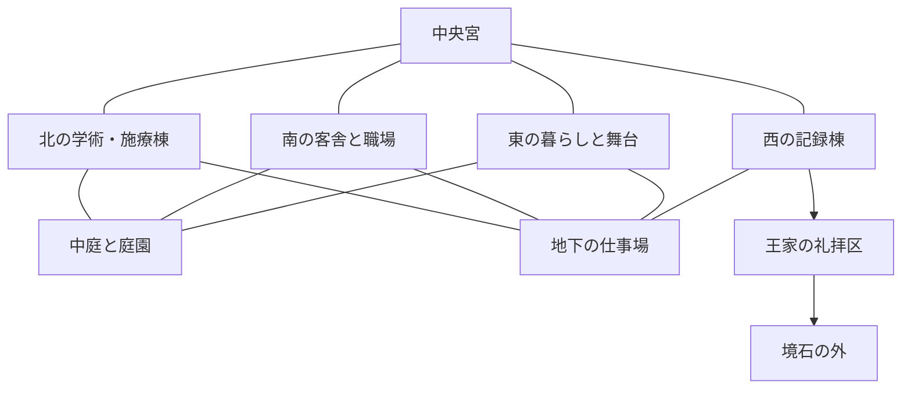

# 城内地図　59地点

[資料の目次](README.md) ・ [最短行程](main-route.md) ・ [城内地図](castle.md) ・ [人物](cast.md)

各部屋の「徒歩で隣接」をたどると、次にどこへ行けるか分かる。移動は双方向。敷地外の草地を含む境界地点はQ05だけで、南門検札所も馬車溜も敷地内にある。

謁見前はC01のみ。謁見後は中央宮から四方と庭、地下の職場へ歩ける。W04→Q01は香車の予約後。Q01→Q02は解除後、Q02→Q03は未発見での横断後、Q03→Q04は像の開扉後。Q04からQ05の外側に足を置く操作が最終行程。逃走中の目撃・失敗で戻る先は[状態と死に戻り](rules.md)に示す。

図は区域間の代表的な移動を示す。個々の直通路は下の「徒歩で隣接」にすべて載せた。

## 中央宮

### C01　玉座の間

二回の呼びかけが響く赤い絨毯。客席と王座では織物の見え方が違う。

**徒歩で隣接**　[C02 拝謁前室](#c02)

**ここで起こる場面**　[M01](main-route.md#m01) ・ [M02](main-route.md#m02) ・ [E001](threads/T01.md#e001) ・ [E002](threads/T01.md#e002) ・ [E011](threads/T01.md#e011)

### C02　拝謁前室

侍従が客を整列させる。戸外の景色に見える物もここでは舞台幕。

**徒歩で隣接**　[C01 玉座の間](#c01) ／ [C03 紋章廊](#c03) ／ [C05 衣装小部屋](#c05) ／ [C07 中央回廊](#c07)

**ここで起こる場面**　[E003](threads/T01.md#e003) ・ [E006](threads/T01.md#e006) ・ [E013](threads/T01.md#e013)

### C03　紋章廊

式の違いを指でなぞれる浮き彫りが並ぶ。

**徒歩で隣接**　[C02 拝謁前室](#c02) ／ [C04 楽師桟敷](#c04) ／ [W03 肖像修復室](#w03)

**ここで起こる場面**　[E005](threads/T01.md#e005) ・ [E007](threads/T01.md#e007) ・ [E014](threads/T01.md#e014)

### C04　楽師桟敷

床から客席へ音がぬける。楽師の合図は光にも映る。

**徒歩で隣接**　[C03 紋章廊](#c03) ／ [E08 小劇場](#e08)

**ここで起こる場面**　途中の移動地点

### C05　衣装小部屋

稽古用の剣と客の礼装を別の箱に収める。

**徒歩で隣接**　[C02 拝謁前室](#c02) ／ [C08 客人寝室](#c08) ／ [E04 衣装繕い室](#e04)

**ここで起こる場面**　[E009](threads/T01.md#e009) ・ [E101](threads/T07.md#e101)

### C06　客人談話室

城に呼ばれた者が席に残した走り書き。

**徒歩で隣接**　[C07 中央回廊](#c07) ／ [C08 客人寝室](#c08) ／ [S02 冬客間](#s02)

**ここで起こる場面**　[E008](threads/T01.md#e008) ・ [E010](threads/T01.md#e010) ・ [E063](threads/T05.md#e063) ・ [E071](threads/T05.md#e071)

### C07　中央回廊

東西南北と庭を結ぶ。床の色と壁の浮き彫りで方角を選べる。

**徒歩で隣接**　[C02 拝謁前室](#c02) ／ [C06 客人談話室](#c06) ／ [E02 東廊下](#e02) ／ [G02 中庭噴泉](#g02) ／ [N02 施療院](#n02) ／ [S05 城内側馬車溜](#s05) ／ [W01 西資料室](#w01)

**ここで起こる場面**　[E015](threads/T01.md#e015)

### C08　客人寝室

召喚客の荷を預かる。机には自分の文字でメモできる空きがある。

**徒歩で隣接**　[C05 衣装小部屋](#c05) ／ [C06 客人談話室](#c06) ／ [S02 冬客間](#s02)

**ここで起こる場面**　[E012](threads/T01.md#e012) ・ [E066](threads/T05.md#e066) ・ [E094](threads/T07.md#e094)

## 西の記録棟

### W01　西資料室

貸出棚に移転後も使われている備品図がある。

**徒歩で隣接**　[C07 中央回廊](#c07) ／ [W02 織物回廊](#w02) ／ [W05 写字室](#w05) ／ [W06 地図架室](#w06)

**ここで起こる場面**　[M03](main-route.md#m03)

### W02　織物回廊

裏見台は短い日なたを横切る。表側の回廊は自由に歩ける。

**徒歩で隣接**　[W01 西資料室](#w01) ／ [W03 肖像修復室](#w03) ／ [W08 壁画足場](#w08)

**ここで起こる場面**　[M10](main-route.md#m10) ・ [E080](threads/T06.md#e080) ・ [E082](threads/T06.md#e082) ・ [E088](threads/T06.md#e088)

### W03　肖像修復室

王女の肖像と、裏打ち紙を傾けるための額台。

**徒歩で隣接**　[C03 紋章廊](#c03) ／ [W02 織物回廊](#w02) ／ [W04 香支度室](#w04) ／ [W08 壁画足場](#w08)

**ここで起こる場面**　[M14](main-route.md#m14) ・ [E136](threads/T10.md#e136) ・ [E140](threads/T10.md#e140) ・ [E144](threads/T10.md#e144) ・ [E147](threads/T10.md#e147) ・ [E148](threads/T10.md#e148) ・ [E150](threads/T10.md#e150)

### W04　香支度室

香車と当番盤がつながる。予約後に無音祈祷室の戸が開く。

**徒歩で隣接**　[Q01 無音祈祷室](#q01) ／ [W03 肖像修復室](#w03)

**ここで起こる場面**　[M16](main-route.md#m16)

### W05　写字室

城内の誰がどの言葉を書いたか、手つきの跡が残る。

**徒歩で隣接**　[W01 西資料室](#w01) ／ [W07 製本台の間](#w07)

**ここで起こる場面**　[E131](threads/T09.md#e131) ・ [E138](threads/T10.md#e138) ・ [E142](threads/T10.md#e142) ・ [E149](threads/T10.md#e149)

### W06　地図架室

地図を年代別に吊るす。退出先の「外」が敷地外を指すとは限らない。

**徒歩で隣接**　[B06 帳票庫](#b06) ／ [N08 標本廊](#n08) ／ [W01 西資料室](#w01) ／ [W07 製本台の間](#w07)

**ここで起こる場面**　[E092](threads/T07.md#e092) ・ [E103](threads/T07.md#e103)

### W07　製本台の間

裁ち紙が箱の底に再利用される。

**徒歩で隣接**　[B06 帳票庫](#b06) ／ [W05 写字室](#w05) ／ [W06 地図架室](#w06)

**ここで起こる場面**　[E097](threads/T07.md#e097) ・ [E139](threads/T10.md#e139)

### W08　壁画足場

高い足場から絵の継ぎ目を調べられる。

**徒歩で隣接**　[G03 果樹回廊](#g03) ／ [W02 織物回廊](#w02) ／ [W03 肖像修復室](#w03)

**ここで起こる場面**　[E043](threads/T03.md#e043) ・ [E083](threads/T06.md#e083) ・ [E137](threads/T10.md#e137) ・ [E141](threads/T10.md#e141) ・ [E143](threads/T10.md#e143) ・ [E145](threads/T10.md#e145) ・ [E146](threads/T10.md#e146)

## 東の暮らしと舞台

### E01　洗濯仕分け場

干し台の表に当日の衣類、裏に古い印が残る。

**徒歩で隣接**　[E02 東廊下](#e02) ／ [E04 衣装繕い室](#e04) ／ [E05 物干し屋根](#e05)

**ここで起こる場面**　[M04](main-route.md#m04) ・ [E016](threads/T02.md#e016) ・ [E018](threads/T02.md#e018) ・ [E027](threads/T02.md#e027) ・ [E029](threads/T02.md#e029)

### E02　東廊下

舞台の返却品が入る星箱が壁際にある。

**徒歩で隣接**　[C07 中央回廊](#c07) ／ [E01 洗濯仕分け場](#e01) ／ [E06 舞台倉](#e06) ／ [E07 東詰所](#e07)

**ここで起こる場面**　[M09](main-route.md#m09) ・ [E021](threads/T02.md#e021) ・ [E030](threads/T02.md#e030)

### E03　王家の鳩舎

世話道具の棚の上に王女専用の返書筒が残る。

**徒歩で隣接**　[E05 物干し屋根](#e05) ／ [N06 天文露台](#n06)

**ここで起こる場面**　[M13](main-route.md#m13) ・ [E121](threads/T09.md#e121) ・ [E122](threads/T09.md#e122) ・ [E124](threads/T09.md#e124) ・ [E126](threads/T09.md#e126) ・ [E128](threads/T09.md#e128) ・ [E132](threads/T09.md#e132) ・ [E133](threads/T09.md#e133)

### E04　衣装繕い室

縁の縫い方と裏地で持ち主の仕事を読む。

**徒歩で隣接**　[C05 衣装小部屋](#c05) ／ [E01 洗濯仕分け場](#e01) ／ [E06 舞台倉](#e06)

**ここで起こる場面**　[E017](threads/T02.md#e017) ・ [E020](threads/T02.md#e020) ・ [E022](threads/T02.md#e022) ・ [E024](threads/T02.md#e024)

### E05　物干し屋根

屋根には風向き旗と鳩のための雨覆い。

**徒歩で隣接**　[E01 洗濯仕分け場](#e01) ／ [E03 王家の鳩舎](#e03) ／ [G03 果樹回廊](#g03)

**ここで起こる場面**　[E023](threads/T02.md#e023) ・ [E025](threads/T02.md#e025) ・ [E026](threads/T02.md#e026) ・ [E123](threads/T09.md#e123) ・ [E127](threads/T09.md#e127) ・ [E130](threads/T09.md#e130) ・ [E135](threads/T09.md#e135)

### E06　舞台倉

衣装箱の中に舞台用の宝箱や道具が紛れる。

**徒歩で隣接**　[B05 舞台奈落](#b05) ／ [E02 東廊下](#e02) ／ [E04 衣装繕い室](#e04) ／ [E08 小劇場](#e08)

**ここで起こる場面**　[E028](threads/T02.md#e028) ・ [E076](threads/T06.md#e076) ・ [E079](threads/T06.md#e079) ・ [E084](threads/T06.md#e084) ・ [E089](threads/T06.md#e089)

### E07　東詰所

立入線の外に遺失物の受け渡し窓がある。

**徒歩で隣接**　[E02 東廊下](#e02) ／ [S05 城内側馬車溜](#s05)

**ここで起こる場面**　[E085](threads/T06.md#e085)

### E08　小劇場

客席、舞台袖、巻き上げ幕が一つの部屋を分ける。

**徒歩で隣接**　[B05 舞台奈落](#b05) ／ [C04 楽師桟敷](#c04) ／ [E06 舞台倉](#e06)

**ここで起こる場面**　[E004](threads/T01.md#e004) ・ [E077](threads/T06.md#e077) ・ [E081](threads/T06.md#e081) ・ [E087](threads/T06.md#e087) ・ [E090](threads/T06.md#e090)

## 北の学術・施療棟

### N01　窯見本室

釉薬の色が似ていても、縁と溝は違う。

**徒歩で隣接**　[N02 施療院](#n02) ／ [N05 鐘鋳場](#n05)

**ここで起こる場面**　[M05](main-route.md#m05) ・ [E031](threads/T03.md#e031) ・ [E032](threads/T03.md#e032) ・ [E035](threads/T03.md#e035) ・ [E039](threads/T03.md#e039) ・ [E041](threads/T03.md#e041) ・ [E042](threads/T03.md#e042)

### N02　施療院

首輪の印に対応する救護札と、召喚者の経過を収めた棚。

**徒歩で隣接**　[C07 中央回廊](#c07) ／ [N01 窯見本室](#n01) ／ [N04 薬草乾燥室](#n04) ／ [N07 療養温室](#n07)

**ここで起こる場面**　[M07](main-route.md#m07) ・ [E019](threads/T02.md#e019) ・ [E059](threads/T04.md#e059) ・ [E061](threads/T05.md#e061) ・ [E064](threads/T05.md#e064) ・ [E067](threads/T05.md#e067) ・ [E069](threads/T05.md#e069) ・ [E072](threads/T05.md#e072) ・ [E073](threads/T05.md#e073)

### N03　星暦室

王家が使った冬至の星穴盤が残る。

**徒歩で隣接**　[N06 天文露台](#n06) ／ [N08 標本廊](#n08)

**ここで起こる場面**　[M12](main-route.md#m12) ・ [E106](threads/T08.md#e106) ・ [E111](threads/T08.md#e111) ・ [E112](threads/T08.md#e112) ・ [E117](threads/T08.md#e117) ・ [E119](threads/T08.md#e119)

### N04　薬草乾燥室

乾燥紐の高さが薬草の用途を示す。

**徒歩で隣接**　[N02 施療院](#n02) ／ [N07 療養温室](#n07)

**ここで起こる場面**　[E062](threads/T05.md#e062) ・ [E065](threads/T05.md#e065) ・ [E070](threads/T05.md#e070)

### N05　鐘鋳場

音が出る前の鐘が並び、鋳肌に作り手の印がある。

**徒歩で隣接**　[B03 からくり工房](#b03) ／ [N01 窯見本室](#n01) ／ [N08 標本廊](#n08)

**ここで起こる場面**　[E038](threads/T03.md#e038)

### N06　天文露台

風向きと星穴を同時に読める。

**徒歩で隣接**　[E03 王家の鳩舎](#e03) ／ [G04 日時計庭](#g04) ／ [N03 星暦室](#n03)

**ここで起こる場面**　[E107](threads/T08.md#e107) ・ [E110](threads/T08.md#e110) ・ [E113](threads/T08.md#e113) ・ [E114](threads/T08.md#e114) ・ [E115](threads/T08.md#e115) ・ [E120](threads/T08.md#e120)

### N07　療養温室

低い寝台から届く高さに花の窓がある。

**徒歩で隣接**　[G07 回転温棚](#g07) ／ [N02 施療院](#n02) ／ [N04 薬草乾燥室](#n04)

**ここで起こる場面**　[E068](threads/T05.md#e068) ・ [E074](threads/T05.md#e074) ・ [E075](threads/T05.md#e075)

### N08　標本廊

材料見本と、王家の古い図形見本を保管する。

**徒歩で隣接**　[N03 星暦室](#n03) ／ [N05 鐘鋳場](#n05) ／ [W06 地図架室](#w06)

**ここで起こる場面**　[E033](threads/T03.md#e033) ・ [E045](threads/T03.md#e045) ・ [E108](threads/T08.md#e108) ・ [E118](threads/T08.md#e118) ・ [E129](threads/T09.md#e129)

## 南の客舎と職場

### S01　南返納庫

布と焼き物の二つの照合札で引き出す旧式の箱。

**徒歩で隣接**　[S05 城内側馬車溜](#s05) ／ [S08 食器棚室](#s08)

**ここで起こる場面**　[M06](main-route.md#m06) ・ [E037](threads/T03.md#e037) ・ [E044](threads/T03.md#e044)

### S02　冬客間

子供部屋から移した背くらべ柱だけ壁紙が薄い。

**徒歩で隣接**　[C06 客人談話室](#c06) ／ [C08 客人寝室](#c08) ／ [S06 宴会厨房](#s06)

**ここで起こる場面**　[M11](main-route.md#m11) ・ [E091](threads/T07.md#e091) ・ [E093](threads/T07.md#e093) ・ [E095](threads/T07.md#e095) ・ [E098](threads/T07.md#e098) ・ [E100](threads/T07.md#e100) ・ [E102](threads/T07.md#e102) ・ [E104](threads/T07.md#e104)

### S03　鐘番室

巡回環を貸し出す当番盤と時刻の刻み。

**徒歩で隣接**　[S04 南門検札所](#s04) ／ [S05 城内側馬車溜](#s05)

**ここで起こる場面**　[M15](main-route.md#m15)

### S04　南門検札所

礼法が通るのは内側の検札線まで。外扉は常に閉じる。

**徒歩で隣接**　[S03 鐘番室](#s03) ／ [S05 城内側馬車溜](#s05)

**ここで起こる場面**　途中の移動地点

### S05　城内側馬車溜

外の町が見えても、検札所とすべての馬車は敷地内にある。

**徒歩で隣接**　[C07 中央回廊](#c07) ／ [E07 東詰所](#e07) ／ [G02 中庭噴泉](#g02) ／ [S01 南返納庫](#s01) ／ [S03 鐘番室](#s03) ／ [S04 南門検札所](#s04) ／ [S06 宴会厨房](#s06)

**ここで起こる場面**　途中の移動地点

### S06　宴会厨房

地下から配膳し、欠けた食器は別棚へ返す。

**徒歩で隣接**　[B07 地下配膳廊](#b07) ／ [S02 冬客間](#s02) ／ [S05 城内側馬車溜](#s05) ／ [S07 パン窯室](#s07) ／ [S08 食器棚室](#s08)

**ここで起こる場面**　[E134](threads/T09.md#e134)

### S07　パン窯室

余熱で菓子を焼く夜番の作業場。

**徒歩で隣接**　[B04 古い給茶室](#b04) ／ [S06 宴会厨房](#s06)

**ここで起こる場面**　途中の移動地点

### S08　食器棚室

印の違う皿と、贈り物の箱を分けて保管する。

**徒歩で隣接**　[B07 地下配膳廊](#b07) ／ [S01 南返納庫](#s01) ／ [S06 宴会厨房](#s06)

**ここで起こる場面**　[E034](threads/T03.md#e034)

## 中庭と庭園

### G01　雨量庭園

旧雨量計の鷺は左脚の水を抜くと預かり筒が開く。

**徒歩で隣接**　[B01 旧水位室](#b01) ／ [G02 中庭噴泉](#g02) ／ [G05 庭師小屋](#g05)

**ここで起こる場面**　[M08](main-route.md#m08) ・ [E046](threads/T04.md#e046) ・ [E051](threads/T04.md#e051) ・ [E054](threads/T04.md#e054) ・ [E058](threads/T04.md#e058)

### G02　中庭噴泉

地上の四方を見比べられる。水の出口はすべて庭の循環池。

**徒歩で隣接**　[C07 中央回廊](#c07) ／ [G01 雨量庭園](#g01) ／ [G03 果樹回廊](#g03) ／ [G04 日時計庭](#g04) ／ [G06 舟遊び池](#g06) ／ [S05 城内側馬車溜](#s05)

**ここで起こる場面**　[E050](threads/T04.md#e050)

### G03　果樹回廊

物干しの影が枝と重なる。

**徒歩で隣接**　[E05 物干し屋根](#e05) ／ [G02 中庭噴泉](#g02) ／ [G05 庭師小屋](#g05) ／ [G07 回転温棚](#g07) ／ [W08 壁画足場](#w08)

**ここで起こる場面**　[E057](threads/T04.md#e057) ・ [E125](threads/T09.md#e125)

### G04　日時計庭

光と石の切り欠きで時刻を比べられる。

**徒歩で隣接**　[G02 中庭噴泉](#g02) ／ [G06 舟遊び池](#g06) ／ [N06 天文露台](#n06)

**ここで起こる場面**　[E109](threads/T08.md#e109) ・ [E116](threads/T08.md#e116)

### G05　庭師小屋

道具を形で返す棚と、過去の水量帳。

**徒歩で隣接**　[G01 雨量庭園](#g01) ／ [G03 果樹回廊](#g03) ／ [G06 舟遊び池](#g06)

**ここで起こる場面**　[E047](threads/T04.md#e047) ・ [E053](threads/T04.md#e053)

### G06　舟遊び池

舟は城内の池だけを往復する。

**徒歩で隣接**　[G02 中庭噴泉](#g02) ／ [G04 日時計庭](#g04) ／ [G05 庭師小屋](#g05) ／ [G07 回転温棚](#g07)

**ここで起こる場面**　[E049](threads/T04.md#e049) ・ [E060](threads/T04.md#e060) ・ [E096](threads/T07.md#e096) ・ [E099](threads/T07.md#e099) ・ [E105](threads/T07.md#e105)

### G07　回転温棚

日を追って鉢棚が回り、葉の裏の印が見える。

**徒歩で隣接**　[G03 果樹回廊](#g03) ／ [G06 舟遊び池](#g06) ／ [N07 療養温室](#n07)

**ここで起こる場面**　途中の移動地点

## 地下の仕事場

### B01　旧水位室

目盛板の裏に昔の事故名が刻まれた。

**徒歩で隣接**　[B02 貯氷室](#b02) ／ [B03 からくり工房](#b03) ／ [G01 雨量庭園](#g01)

**ここで起こる場面**　[E048](threads/T04.md#e048) ・ [E052](threads/T04.md#e052) ・ [E055](threads/T04.md#e055) ・ [E056](threads/T04.md#e056)

### B02　貯氷室

春の氷を夏まで包む。入口から救護の呼び紐が届く。

**徒歩で隣接**　[B01 旧水位室](#b01) ／ [B04 古い給茶室](#b04) ／ [B07 地下配膳廊](#b07)

**ここで起こる場面**　途中の移動地点

### B03　からくり工房

壊れた水鳥や鐘の部品を試す場所。

**徒歩で隣接**　[B01 旧水位室](#b01) ／ [B05 舞台奈落](#b05) ／ [N05 鐘鋳場](#n05)

**ここで起こる場面**　[E036](threads/T03.md#e036) ・ [E040](threads/T03.md#e040)

### B04　古い給茶室

見舞い客が和解の茶を用意する。

**徒歩で隣接**　[B02 貯氷室](#b02) ／ [B07 地下配膳廊](#b07) ／ [S07 パン窯室](#s07)

**ここで起こる場面**　途中の移動地点

### B05　舞台奈落

迫り台は舞台までの垂直移動用で、城外には続かない。

**徒歩で隣接**　[B03 からくり工房](#b03) ／ [B07 地下配膳廊](#b07) ／ [E06 舞台倉](#e06) ／ [E08 小劇場](#e08)

**ここで起こる場面**　[E078](threads/T06.md#e078) ・ [E086](threads/T06.md#e086)

### B06　帳票庫

書き換え前の受領控えと廃棄寸前の手紙。

**徒歩で隣接**　[B07 地下配膳廊](#b07) ／ [W06 地図架室](#w06) ／ [W07 製本台の間](#w07)

**ここで起こる場面**　途中の移動地点

### B07　地下配膳廊

氷と料理の運搬路。行き着く先は城内の食器棚。

**徒歩で隣接**　[B02 貯氷室](#b02) ／ [B04 古い給茶室](#b04) ／ [B05 舞台奈落](#b05) ／ [B06 帳票庫](#b06) ／ [S06 宴会厨房](#s06) ／ [S08 食器棚室](#s08)

**ここで起こる場面**　途中の移動地点

## 王家の礼拝区と境界

### Q01　無音祈祷室

香車の予約で開く。扉を閉めると留め金の音も漏れない。

**徒歩で隣接**　[Q02 白礼拝廊](#q02) ／ [W04 香支度室](#w04)

**ここで起こる場面**　[M17](main-route.md#m17)

### Q02　白礼拝廊

番のいる中央の白床と、無人時間に渡れる白百合の縁。

**徒歩で隣接**　[Q01 無音祈祷室](#q01) ／ [Q03 旧礼拝堂](#q03)

**ここで起こる場面**　[M18](main-route.md#m18)

### Q03　旧礼拝堂

冠なき像の背に、遠方から持ってきた覗き錘が収まる。

**徒歩で隣接**　[Q02 白礼拝廊](#q02) ／ [Q04 王家の抜け穴](#q04)

**ここで起こる場面**　[M19](main-route.md#m19)

### Q04　王家の抜け穴

雨水路とは独立した王家の通路。入口を越えても城の敷地内。

**徒歩で隣接**　[Q03 旧礼拝堂](#q03) ／ [Q05 境石と外の草地](#q05)

**ここで起こる場面**　途中の移動地点

### Q05　境石と外の草地

境石の内側の靴跡と外側の野草。内から外へ踏み越えた瞬間が終点。

**徒歩で隣接**　[Q04 王家の抜け穴](#q04)

**ここで起こる場面**　[M20](main-route.md#m20)
