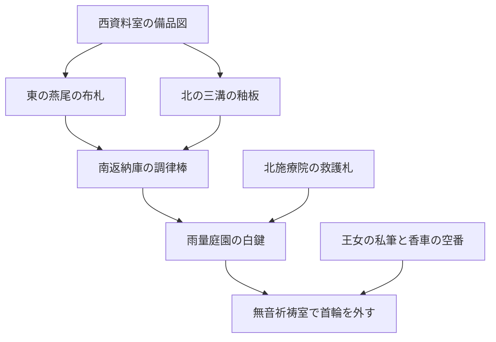
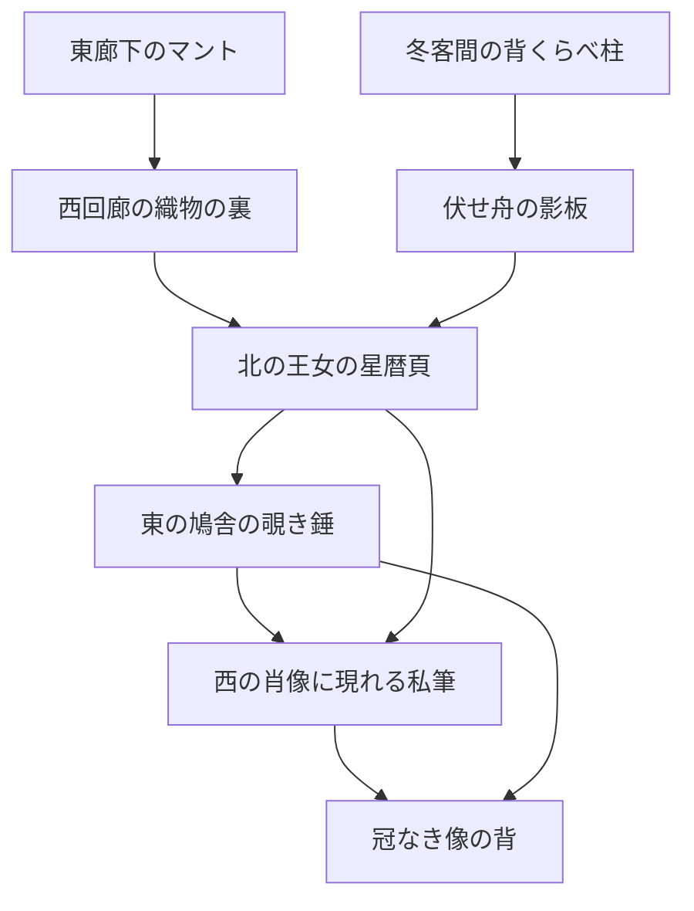

# どこで何がつながるか

[資料の目次](README.md) ・ [最短20行程](main-route.md) ・ [道具の所在と使い道](items.md)

この城で同じ物が別の役を果たす例が、真鍮の卵である。鳩舎では空の返書筒の重し、西の肖像の前では文字を読むレンズ、旧礼拝堂では入口を開ける最後の重さになる。正体を全部知る人物に聞けば済む場面はない。

## 首輪を外せる物と場所を別々に探す

鳥の左脚と分かっても水は抜けない。左右の札を集めて棒を取り、救護札の窓で棒を支えると、初めて鷺が鍵を返す。鍵を見つけた喜びの直後に「どこなら留め金の声を聞かれないか」という次の問いが生まれる。[雨量庭園での入手](main-route.md#m08) ・ [解除する行程](main-route.md#m17)

## 王女の居場所から見直す

子供の目の高さに残した舟の印は、暦の読み方になる。庭師や鳩番の話だけで入口を当てることはできない。星暦頁と覗き錘で王女の私筆を読み、場所と作法を主人公が自分の絵に直す。解除後はこの絵が読める。[子供部屋の柱](main-route.md#m11) ・ [私筆の全文を読む場面](main-route.md#m14) ・ [冠なき像](main-route.md#m19)

## 寄り道で、本当に違う部屋へ行く

| 起点 | 一方の枝 | もう一方の枝 | あとで結果が返る場所 |
| --- | --- | --- | --- |
| [余った氷は一片だけ](threads/T13.md#e185) | [施療院の寝台へ運び、笑顔の絵をもらう](threads/T13.md#e192) | [地下の給茶室で夜番に配り、七つの茶染みを残す](threads/T13.md#e194) | [返却盆の中身が変わる](threads/T13.md#e195) |
| [前の客の未開封の手紙](threads/T16.md#e230) | [ニナと読んで、客人寝室の横灯を試す](threads/T16.md#e237) | [封を守り、製本台でニナと外封筒を折る](threads/T16.md#e239) | [帳簿に二人の呼び名か「本人受領」が残る](threads/T16.md#e240) |
| [庭に出られないマオ](threads/T17.md#e246) | [花を病室に運んで本人と待つ](threads/T17.md#e251) | [果樹回廊で子供と鏡を合わせる](threads/T17.md#e248) | [鉢を返す絵か、庭へ窓を開く絵](threads/T17.md#e255) |

## 勘違いを自分で取り消せる

南門では、礼が正しいことと脱出できることを別々に確かめられる。右胸を二度たたくと番が笑って内格子を開ける。そこで外扉の閂を見上げるとまだ動いていない。荷の許可を取っても人の欄は空白のまま。ここまで調べた人は南門に閉門印を付けて、別の棟へ戻れる。[門前の掲示](threads/T11.md#e151) ・ [礼を試す](threads/T11.md#e152) ・ [荷と人の違い](threads/T11.md#e159) ・ [蝶番を数える](threads/T11.md#e161)

旅商の金色の章は、礼装箱に合わせて子供用衣装の飾りだと分かる。選べるのは嘘を見破るかどうかの先にもある。訂正を皆に聞こえるようにするか、売り手にだけ返すかで、後に南門の噂が掲示板に載るか、商人の手帳にとどまるかが変わる。[飾り章を借りる](threads/T01.md#e008) ・ [箱の中を確かめる](threads/T01.md#e009) ・ [どこで訂正するか](threads/T01.md#e010) ・ [南門の噂の続き](threads/T11.md#e160)

## 本筋から離れてよい話

厨房の「王様一人ぶん」は国王の注文に見える。皿の裏を返せば子供の字。菓子型の王冠は本物より歯が一つ多い。昔パンを七人で分けた配膳人を、仲間は「王様」と呼んでいた。空いた七席目を思い出の席として残すか、遅番の誰かに空けておくかまで遊べる。ここで何を選んでも最短の脱出に必要な物は変わらない。[食卓の空の皿](threads/T12.md#e166) ・ [あだ名の由来](threads/T12.md#e169) ・ [七席目の選択](threads/T12.md#e173) ・ [最後のひと皿](threads/T12.md#e180)
